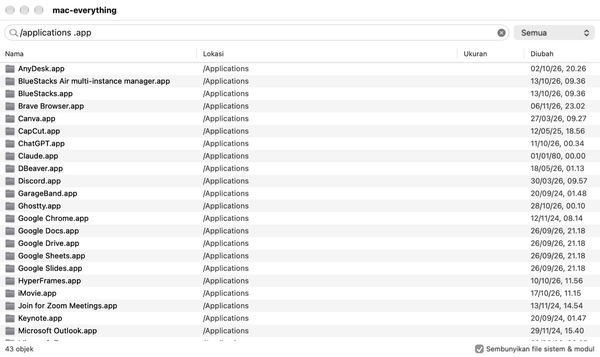

# mac-everything

Pencarian nama file instan untuk macOS. Ketik beberapa huruf, daftarnya langsung menyusut ke file yang Anda cari.

Spotlight mencari di mana-mana sekaligus: isi dokumen, email, kontak, sampai saran dari web. mac-everything mengerjakan satu hal saja, yaitu mencocokkan nama file, terinspirasi oleh Everything dari voidtools untuk Windows.

**Unduh:** [ihsanmokhsen.github.io/mac-everything](https://ihsanmokhsen.github.io/mac-everything/)



## Cara mencari

| Ketik | Artinya |
|---|---|
| `laporan pdf` | Spasi berarti DAN: nama harus memuat kedua kata. |
| `laporan !draf` | Tanda seru mengecualikan: memuat "laporan" tetapi tidak "draf". |
| `kantor/laporan` | Garis miring mencocokkan seluruh path, bukan hanya nama file. |

## Cara memasang

1. Unduh `mac-everything.dmg`, lalu klik dua kali.
2. Seret ikon mac-everything ke folder Applications.
3. Aplikasi ini belum dinotarisasi Apple, jadi macOS akan menahannya saat pertama dibuka. Buka System Settings → Privacy & Security, lalu klik "Open Anyway". Cukup sekali.

Untuk memastikan file unduhan asli, cocokkan checksum-nya dengan yang tertera di halaman unduhan:

```bash
shasum -a 256 ~/Downloads/mac-everything.dmg
```

Syarat: macOS 12 ke atas, Mac Apple Silicon.

## Cara kerja

- Hanya nama file yang diindeks, bukan isinya. Seluruh indeks muat di memori dan dipindai paralel di semua inti CPU.
- Perubahan di disk dipantau terus lewat FSEvents, jadi file baru, dipindah, atau dihapus langsung tercermin di hasil.
- Indeks disimpan ke `~/Library/Caches/mac-everything`, jadi saat aplikasi dibuka lagi Anda bisa langsung mencari.
- Aplikasi tidak mengirim data ke mana pun. Seluruh kodenya ada di `main.swift`.

## Membangun sendiri

Cukup Command Line Tools, tanpa Xcode.

```bash
./build.sh      # membangun mac-everything.app
./makedmg.sh    # membungkusnya menjadi mac-everything.dmg
./makeicon.sh   # membuat ulang AppIcon.icns (opsional)
```

## Lisensi

[MIT](LICENSE) © 2026 [ihsanmokhsen](https://ihsanmokhsen.com)
